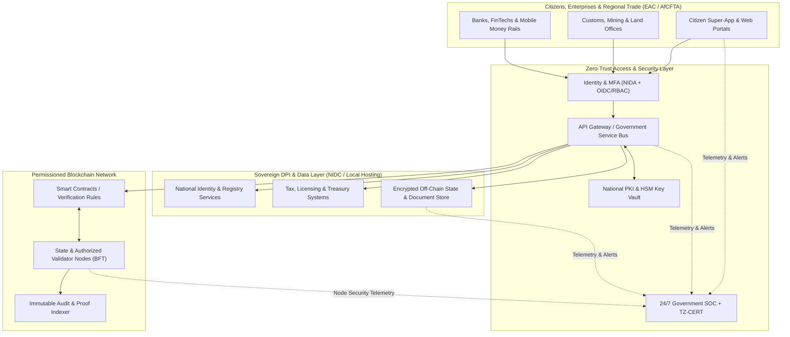
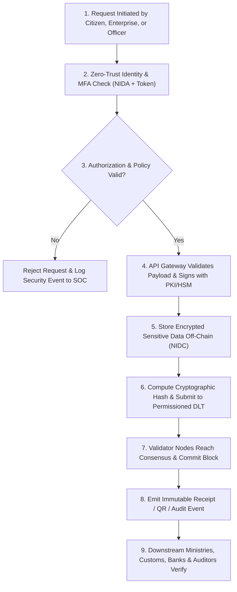
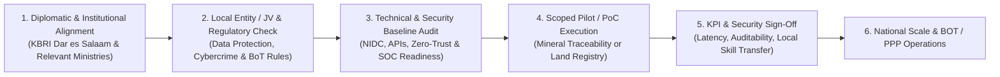

  

# 🇹🇿 Tanzania Digital Sovereignty Framework

### Sovereign Digital Public Infrastructure, Permissioned Blockchain & National Cybersecurity

**A Strategic Framework for Tanzania's Digital Sovereignty**

---

## 1. Executive Overview

The Tanzania Digital Sovereignty Framework is a strategic policy, enterprise IT, permissioned blockchain, and Zero-Trust cybersecurity blueprint for the United Republic of Tanzania.

The framework is designed to support sovereign Digital Public Infrastructure (DPI), high-integrity public digital ledgers, national cybersecurity resilience, and Indonesia–Tanzania bilateral technology collaboration.

Its central objective is to establish an interoperable, secure, and nationally governed digital infrastructure that strengthens public administration, financial integrity, economic transparency, and technological independence.

The framework focuses on four strategic pillars:

1. Sovereign E-Government and Digital Public Infrastructure.
2. Government Permissioned Blockchain and Distributed Ledger Technology.
3. National Zero-Trust Cybersecurity and Digital Trust.
4. Indonesia–Tanzania Bilateral Technology Partnership.

## 2. Strategic Context

Tanzania has established important digital foundations, including:

- National ICT Broadband Backbone (NICTBB).
- National Internet Data Center (NIDC).
- National Identification Authority (NIDA).
- Expanding digital government services.
- Widespread mobile money adoption.

To transform these foundations into high-trust national digital infrastructure, several challenges must be addressed:

- Fragmented data exchange across ministries and public registries.
- Vulnerability to document forgery and asset disputes.
- Supply-chain and mineral royalty leakage.
- Growing cyber threats against critical public, financial, and logistics systems.
- Limited interoperability between government institutions.
- Need for stronger national digital capacity and technology transfer.

The proposed framework provides a conceptual architecture to address these challenges through secure integration, cryptographic verification, and institutional governance.

## 3. Core Strategic Pillars

### 3.1 Sovereign E-Government and Digital Public Infrastructure

Develop interoperable government services connecting:

- National identity.
- Tax administration.
- Business registration.
- Land administration.
- Health services.
- Customs and trade.
- Public treasury systems.

The objective is to standardize data exchange through secure APIs while supporting national data governance and appropriate local data hosting.

### 3.2 Government Permissioned Blockchain

Deploy enterprise-grade permissioned Distributed Ledger Technology (DLT) for high-integrity government operations.

Potential use cases include:

- Land title issuance and verification.
- Mineral and agricultural export traceability.
- Public procurement auditing.
- Digital government credentials.
- Document authentication.
- Regulatory and institutional audit trails.

The network would operate under authorized institutional governance rather than unrestricted public validation.

### 3.3 National Zero-Trust Cybersecurity

Establish a national cybersecurity framework based on the principle:

**Never Trust, Always Verify.**

Key components:

- Identity verification and MFA.
- Network micro-segmentation.
- National Public Key Infrastructure (PKI).
- Hardware Security Modules (HSM).
- Security Operations Center (SOC).
- Threat intelligence and incident response.
- Continuous vulnerability assessment.

### 3.4 Indonesia–Tanzania Bilateral Technology Partnership

Explore cooperation through:

- Joint Ventures (JV).
- Build-Operate-Transfer (BOT).
- Public-Private Partnerships (PPP).
- Technology transfer.
- Local engineering development.
- Cybersecurity training.
- Government-to-Government (G2G) and Business-to-Government (B2G) engagement.

All partnership arrangements remain subject to institutional approval, applicable laws, procurement requirements, and commercial agreements.

---

## 4. Repository Scope and Strategic Components

This README consolidates the complete strategic and technical documentation into one Markdown document.

The framework covers:

| Component | Description |
|---|---|
| Executive Policy | National digital sovereignty strategy |
| Digital Infrastructure | Government interoperability and DPI |
| Permissioned Blockchain | Institutional distributed ledger |
| Digital Identity | Identity verification and credentials |
| Cybersecurity | Zero-Trust and national SOC |
| PKI Infrastructure | Digital signatures and key management |
| Mineral Traceability | Export and supply-chain verification |
| Land Registry | Digital property records |
| Bilateral Cooperation | Indonesia–Tanzania technology partnership |
| Implementation | 36-month phased rollout |

---

## 5. System Architecture Overview

The proposed architecture integrates citizens, enterprises, government agencies, financial institutions, national digital infrastructure, and permissioned blockchain networks.

### 5.1 High-Level Architecture Diagram

### 5.2 Architecture Components

**Citizen and Business Layer**

Provides access to digital government services, financial services, customs, mining administration, and land offices.

**Zero-Trust Access Layer**

Authenticates users, verifies authorization, protects APIs, manages cryptographic keys, and monitors security events.

**Sovereign DPI Layer**

Connects national identity services, treasury systems, licensing platforms, and encrypted data repositories.

**Permissioned Blockchain Layer**

Provides institutional transaction verification, validator consensus, smart contract execution, and tamper-evident audit records.

---

## 6. Detailed Execution Flowcharts

### 6.1 End-to-End Sovereign Transaction and Verification

Example: Land, Mineral, or Digital Credential Verification.

### 6.2 Indonesia–Tanzania B2G / PPP Commercial Rollout

---

## 7. Blockchain and Digital Public Infrastructure Architecture

### 7.1 Design Principles

**Permissioned Over Public-Speculative**

Use consortium or permissioned distributed ledgers where validator nodes are governed by authorized state institutions, regulators, and vetted partners.

**Interoperability First**

Connect registries including identity, tax, business registration, land, and customs through standardized APIs and event queues rather than isolated systems.

**Off-Chain Privacy, On-Chain Proof**

Store sensitive personal or commercial information in encrypted off-chain databases while anchoring cryptographic hashes, state transitions, and audit proofs on the ledger.

### 7.2 High-Value Government Use Cases

| Domain | Core Problem | Proposed Mechanism | Expected Outcome |
|---|---|---|---|
| Land Administration | Disputed boundaries, forged titles, slow transfers | Permissioned title issuance and transfer records | Stronger tenure security |
| Mining and Export | Illicit mineral movement and origin gaps | Cryptographic batch tracking | Improved royalty and tax compliance |
| Public Procurement | Manual contract tracking and delayed audits | Tamper-evident contract and payment logs | Stronger fiscal transparency |
| Digital Credentials | Manual degree and permit verification | Signed digital credentials and QR verification | Faster authentication |
| Cross-Border Settlement | High transaction friction | Supervised regulatory sandbox and regulated settlement testing | Lower settlement friction |

### 7.3 Reference Technology Stack

**Identity and Access Layer**

- National ID integration.
- OIDC / OAuth2.
- Role-Based Access Control (RBAC).
- Attribute-Based Access Control (ABAC).
- Hardware Security Modules (HSM).

**Permissioned Ledger Layer**

Potential enterprise platforms:

- Hyperledger Besu.
- Hyperledger Fabric.
- Quorum-class enterprise nodes.

Consensus and governance:

- Byzantine Fault Tolerance (BFT) consensus.
- Authorized validator nodes.
- Institutional node governance.
- Regulator and auditor observer nodes.

**Integration and Audit Layer**

- API Gateway.
- Enterprise Service Bus.
- Immutable audit logs and verification services.

**Micro-Segmentation**

Isolate databases, ledger validator nodes, API gateways, and citizen portals into distinct security zones.

**Encryption Everywhere**

Use TLS 1.3 in transit and strong AES/HSM-backed key management at rest, with strict key rotation policies.

### 8.1 Zero-Trust Security Controls

**Never Trust, Always Verify**

- Strong identity verification and MFA for all users and services.
- Network micro-segmentation between databases, ledger nodes, API gateways, and citizen portals.
- Least-privilege access controls with RBAC and ABAC.
- Continuous device and session verification.

### 8.2 National SOC and Incident Response

**24/7 Government SOC**

Centralized security monitoring through:

- Security Information and Event Management (SIEM).
- Endpoint Detection and Response (EDR).
- Threat intelligence correlation.
- Security event monitoring.
- Incident response coordination.

**Coordination with TZ-CERT**

Establish structured escalation workflows, sector advisories, and joint incident playbooks for:

- Ransomware.
- Distributed Denial of Service (DDoS).
- Supply-chain compromises.
- Financial fraud.
- Unauthorized system access.

**Node and Smart Contract Hardening**

Continuously monitor validator nodes, RPC endpoints, key vaults, and smart contract logic before and after deployment.

### 8.3 Governance, PKI and Assurance

**National PKI**

Develop a standardized certificate authority hierarchy for official digital signatures, authenticated government portals, and encrypted service-to-service communication.

**Continuous Assurance**

Implement:

- Mandatory vulnerability scanning.
- Independent penetration testing.
- Red-team exercises.
- Security configuration audits.
- ISO/IEC 27001 alignment.
- NIST cybersecurity control alignment.
- Compliance with applicable national data protection and cybercrime laws.

---

## 9. Indonesia–Tanzania IT and Blockchain Partnership

### 9.1 Commercial and Delivery Models

To align with public procurement realities and budget constraints, engagements can be structured around:

**Joint Venture (JV) with Local Entity**

Partner with a registered Tanzanian firm to support local operations, procurement compliance, and long-term institutional engagement.

**Build-Operate-Transfer (BOT)**

Deliver and operate critical platforms or managed security services for an agreed period before transferring operations and knowledge to designated state teams.

**Milestone-Based or Usage/Efficiency PPP**

Explore co-investment in systems such as trade/export traceability and digital verification portals, tied to clear service-level agreements and approved commercial models.

### 9.2 Technology Transfer and Local Capacity

The partnership framework emphasizes sustainable local capabilities.

Proposed activities:

- Train Tanzanian engineers in system integration.
- Develop permissioned ledger operational expertise.
- Build cloud and data-center security capabilities.
- Train cybersecurity and SOC personnel.
- Partner with local universities and technical hubs.
- Support knowledge transfer and local workforce development.

The objective is to avoid permanent foreign vendor lock-in.

### 9.3 Practical G2G / B2G Pitch Strategy

**Step 1 — Engage Diplomatic Channels**

Coordinate through official bilateral and trade channels, including the Embassy of the Republic of Indonesia in Dar es Salaam and relevant business and investment institutions.

**Step 2 — Lead with Concrete Outcomes**

Frame blockchain and cybersecurity around:

- Revenue protection.
- Anti-fraud measures.
- Auditability.
- Service efficiency.
- Institutional transparency.

**Step 3 — Start with a Scoped Pilot**

Propose a time-bound Proof of Concept (PoC) with measurable KPIs:

- System latency.
- Platform uptime.
- Security audit pass rate.
- Cost reduction.
- Administrative processing time.
- Local skills transfer.

**Step 4 — Evaluate and Scale**

Expand only after technical, financial, regulatory, and institutional validation.

---

## 10. Target Stakeholders

Potential institutional stakeholders include:

- Office of the President of the United Republic of Tanzania.
- Ministry of Information, Communication and Information Technology.
- Bank of Tanzania.
- National Identification Authority (NIDA).
- National Internet Data Center (NIDC).
- Relevant government ministries and regulatory bodies.
- Tanzanian technology companies and local implementation partners.
- Indonesian technology companies and institutional partners.
- Relevant diplomatic and bilateral cooperation institutions.

These organizations are identified as potential stakeholders, not confirmed project partners or endorsing institutions.

---

## 11. Phased Implementation Roadmap (36 Months)

### Phase 1 — Foundation and Assessment (Months 1–9)

Objectives:

- Conduct baseline IT and cybersecurity audits.
- Assess existing national digital infrastructure.
- Establish interoperability standards.
- Design national PKI and Zero-Trust foundations.
- Evaluate regulatory sandbox requirements.
- Identify pilot institutions and implementation partners.

Expected deliverables:

- Technical assessment report.
- Digital infrastructure reference architecture.
- Security baseline.
- Interoperability framework.
- Pilot project proposal.

### Phase 2 — Pilot Development (Months 10–21)

Objectives:

- Launch targeted pilot projects.
- Integrate identity verification.
- Test permissioned blockchain infrastructure.
- Introduce continuous security monitoring.
- Evaluate operational performance.

Potential pilots:

- Mineral and export traceability.
- Municipal land registry.
- Digital credential verification.
- Public procurement audit trails.

Expected deliverables:

- Functional pilot platforms.
- Independent security assessment.
- Performance and KPI reports.
- Institutional evaluation.

### Phase 3 — Expansion and Regional Interoperability (Months 22–36)

Objectives:

- Expand validated systems.
- Strengthen government interoperability.
- Develop operational governance.
- Expand local engineering capabilities.
- Explore regional East African digital trade and verification interoperability.

Expected deliverables:

- Validated deployment framework.
- Operational documentation.
- Local training programs.
- National expansion strategy.
- Regional interoperability proposal.

---

## 12. Key Performance Indicators (KPIs)

Implementation performance should be evaluated through measurable indicators.

| Category | Proposed KPI |
|---|---|
| Availability | Platform uptime |
| Security | Critical vulnerability remediation |
| Identity | Successful authentication rate |
| Integration | Number of interoperable services |
| Blockchain | Transaction verification performance |
| Audit | Completeness of audit records |
| Traceability | Verified supply-chain transactions |
| Efficiency | Administrative processing time |
| Capacity Building | Number of locally trained engineers |
| Governance | Institutional approval and compliance milestones |

Specific KPI targets must be established after baseline assessments and stakeholder approval.

---

## 13. Governance and Regulatory Considerations

The proposed framework must be aligned with:

- Applicable Tanzanian laws and regulations.
- National data protection requirements.
- Cybersecurity and cybercrime legislation.
- Bank of Tanzania regulatory requirements where financial systems are involved.
- Government procurement and public-private partnership rules.
- Institutional data ownership and access policies.
- National security requirements.
- Relevant regional interoperability frameworks.

No proposed infrastructure should be considered officially approved, deployed, or endorsed until the relevant authorities formally authorize it.

---

## 14. Strategic Objectives

The long-term strategic objectives are:

1. Strengthen Tanzania's digital sovereignty.
2. Improve government service interoperability.
3. Reduce document forgery and administrative fraud.

By combining Digital Public Infrastructure, permissioned blockchain, Zero-Trust cybersecurity, cryptographic verification, and bilateral technology collaboration, the framework seeks to support a more transparent, resilient, and digitally sovereign Tanzania.

Its success depends on government leadership, institutional participation, regulatory compliance, sustainable financing, independent technical validation, and long-term local capacity development.

---

## 15. Disclaimer

This repository provides a strategic and technical reference framework for policy discussion, architecture planning, research, and potential commercial partnership structuring.

It does not represent an official policy, government mandate, approved national infrastructure deployment, confirmed bilateral agreement, or formal endorsement by the Government of Tanzania, the Government of Indonesia, or any named institution.

All proposed systems, partnerships, budgets, implementation specifications, and commercial arrangements require appropriate institutional authorization, legal review, technical validation, and regulatory approval.

---

## 16. Project Support

If this project has helped your research, learning, technology development, or cybersecurity work, consider supporting its continued development.

Contributions, technical discussions, research collaboration, and constructive feedback are welcome.

---

### 🇹🇿 Tanzania Digital Sovereignty Framework

**Digital Sovereignty | Secure Infrastructure | Institutional Trust | Bilateral Cooperation**

*Strategic Blueprint — Policy and Technical Reference*

---

<!-- PROJECT-DOCUMENTATION-INDEX -->

## 📚 Project Documentation

This repository includes the following governance, contribution, and project documentation:

| Document | Description |
|---|---|
| [LICENSE](LICENSE) | MIT License and usage terms |
| [CONTRIBUTING.md](CONTRIBUTING.md) | Contribution guidelines |
| [CODE_OF_CONDUCT.md](CODE_OF_CONDUCT.md) | Community standards |
| [SECURITY.md](SECURITY.md) | Security vulnerability reporting |
| [GOVERNANCE.md](GOVERNANCE.md) | Project governance |
| [SUPPORT.md](SUPPORT.md) | Support and engagement |
| [CHANGELOG.md](CHANGELOG.md) | Project change history |
| [CITATION.cff](CITATION.cff) | Citation metadata |
| [docs/wiki/Technical-Architecture-Diagrams.md](docs/wiki/Technical-Architecture-Diagrams.md) | DPI, permissioned blockchain, Zero Trust, and integration diagrams |
| [docs/wiki/Detailed-Technical-Specifications.md](docs/wiki/Detailed-Technical-Specifications.md) | API, PKI, validator node, and interoperability specifications |
| [docs/wiki/Risk-Management-Framework.md](docs/wiki/Risk-Management-Framework.md) | Technical, operational, regulatory, and governance risk framework |

---

## ☕ Support the Project

If this project has helped your research, learning, or security operations, consider supporting its continued development.

---
