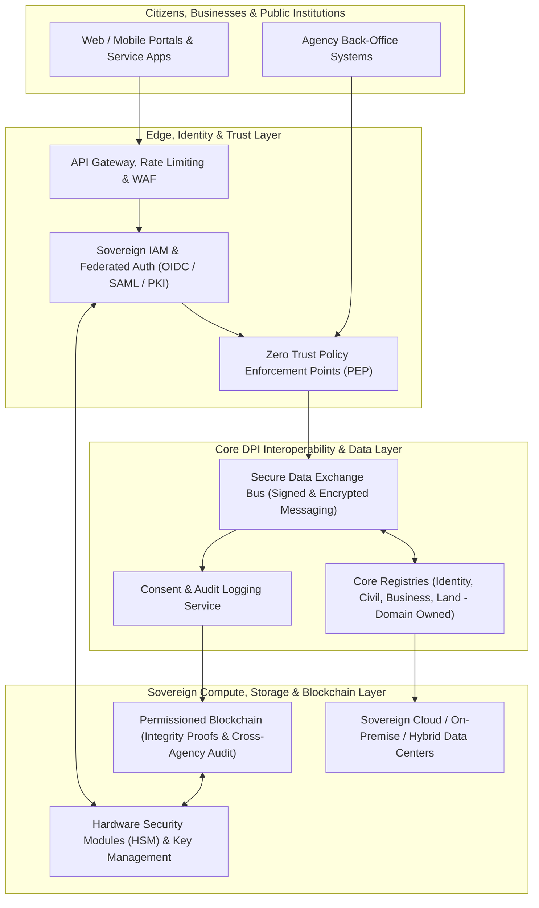
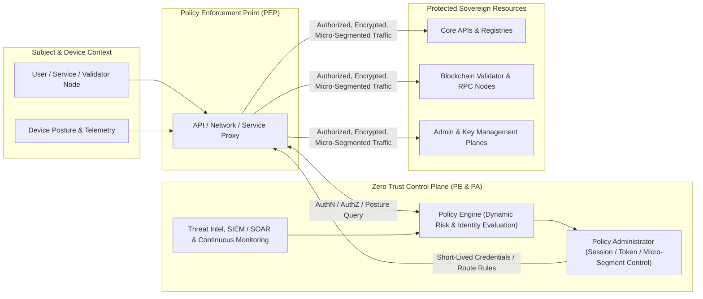

# Technical Architecture Diagrams

> **Status:** Proposed Reference Architecture (Draft for Institutional Review)
> **Scope:** Digital Public Infrastructure (DPI), Permissioned Blockchain, Zero Trust Security, and System Integration for the Tanzania Digital Sovereignty Framework.

---

## 1. Digital Public Infrastructure (DPI) Layered Architecture



**Key Principles:**
* **Domain Ownership:** Each core registry maintains authority over its own data; cross-system exchange happens via signed, encrypted channels.
* **Data & Key Sovereignty:** Cryptographic keys (HSM) and sensitive records remain under clear jurisdictional and operational control.

---

## 2. Permissioned Blockchain & Integrity Verification Flow

```mermaid
sequenceDiagram
    autonumber
    participant App as Agency / Public Service
    participant DB as Sovereign Off-Chain Store (Encrypted)
    participant HashSvc as Canonicalization & Hash Service
    participant Val as Consortium Validator Nodes (Ministries / Agencies)
    participant Ledger as Permissioned Blockchain Ledger

    App->>DB: Store full payload / record (access-controlled)
    App->>HashSvc: Submit record metadata + digest request
    HashSvc->>HashSvc: Compute SHA-256 digest & sign attestation
    HashSvc->>Val: Propose integrity commitment transaction
    Val->>Val: Verify validator signature, policy & consensus rules
    Val->>Ledger: Commit immutable block (hash, timestamp, actor ID)
    Ledger-->>App: Return transaction receipt / proof reference

    Note over App,Ledger: Sensitive PII remains off-chain; only cryptographic proofs & audit events are anchored.
```

**Security & Privacy Notes:**
* Sensitive personal data is not written raw onto a ledger.
* Validator nodes operate under authorized consortium governance with strict cryptographic identity and key lifecycle controls.

---

## 3. Zero Trust Architecture (ZTA) Access & Enforcement



**Core Controls:**
* No implicit trust based solely on network location (including internal networks or VPNs).
* Short-lived tokens/certificates, continuous device posture checks, and least-privilege isolation for admin and validator planes.

---

## 4. Cross-System Integration & Reference Exchange Model

```mermaid
flowchart TB
    subgraph EXT["External / Partner / Reference Systems"]
        REF["Standards, Research & Bilateral Technical Exchange<br/>(e.g., Indonesia–Tanzania Knowledge & Standards Sharing)"]
        PARTNER["Authorized External / Ecosystem Services"]
    end

    subgraph BOUNDARY["Sovereign Boundary & Interoperability Gateway"]
        SCHEMA["Schema Validation, Versioning & Policy Guard"]
        AUDIT["Immutable Audit & Non-Repudiation Log"]
    end

    subgraph INT["Internal Sovereign Services"]
        SVC["DPI Services, Registries & Monitoring"]
    end

    PARTNER -->|"TLS 1.3 + mTLS + Signed Requests"| SCHEMA
    REF -.->|"Policy & Technical Reference Alignment (Non-Binding)"-> SCHEMA
    SCHEMA -->|"Validated & Authorized Calls"| SVC
    SCHEMA --> AUDIT
    SVC --> AUDIT
```

> **Governance Disclaimer:** This diagram represents a proposed reference architecture. Bilateral partnerships, cross-border integrations, or institutional endorsements are only reflected as active when supported by verified evidence and formal agreements.
